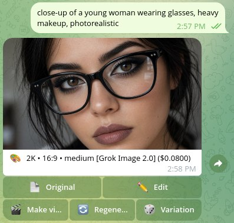
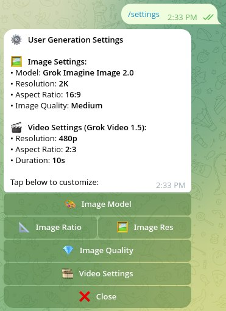

# Syragen

Self-hosted Telegram bot for generating and editing images and generating videos with xAI Grok models through OpenRouter. Written in Go, with local JSON/CSV storage and a Docker Compose deployment.

The source is available under the [MIT license](LICENSE). Each installation uses its own Telegram bot, OpenRouter account, credentials, and authorized users. Generation requires a funded OpenRouter account and access to the configured models.



*Generated image with actions to download the original, edit, make a video, regenerate, or create a variation.*



*Image and video settings with model, resolution, aspect ratio, quality, and duration controls.*

## Quick start

Requirements: Docker Engine with the Compose plugin, outbound HTTPS access to Telegram, OpenRouter, and media download hosts. No inbound ports, public domain, database, or Redis are required.

```bash
git clone https://github.com/fanat-sira/syragen-api.git
cd syragen-api
cp .env.example .env
chmod 600 .env
```

Edit `.env` and fill in the three required values:

| Variable | Value |
| --- | --- |
| `TELEGRAM_BOT_TOKEN` | Token for your own bot from [@BotFather](https://t.me/BotFather) |
| `TELEGRAM_ADMIN_ID` | Your numeric Telegram user ID, not your username or a chat ID |
| `OPENROUTER_MANAGEMENT_KEY` | Your OpenRouter [management key](https://openrouter.ai/settings/management-keys), capable of creating, reading, and deleting API keys |

Keep this file private. The management key grants account-level key management access; a regular inference key is not a substitute.

```bash
docker compose up -d --build
docker compose logs --tail=100 bot
```

Open your bot in a private Telegram chat and send `/start`, then a short image prompt. Only the administrator is authorized on a fresh installation. Use `/adduser <id>` to grant access to other people. Public source code does not make your running bot open to everyone.

## Features and commands

- Plain text → image generation.
- Photo or image document with a caption → image editing.
- Album of up to three images with a caption → editing with multiple references.
- `/video <prompt>` → video generation; attach or reply to a photo for image-to-video.
- `/settings` → image model, resolution, aspect ratio, quality, and video options.
- `/new` → clear the current image editing context.
- `/help` → usage instructions.
- Administrator: `/users`, `/adduser <id>`, `/deluser <id>`, `/spend`.

The implementation uses `x-ai/grok-imagine-image-2.0`, `x-ai/grok-imagine-image-quality`, and `x-ai/grok-imagine-video-1.5`. Image models are chosen through `/settings`; the video model is fixed in the current implementation. The client calls OpenRouter `/images`, `/videos`, and `/keys` endpoints. Model and API access must be verified with your own account; local tests use mock HTTP servers.

## Configuration

All values are read from process environment variables. Docker Compose loads `.env`; the Go binary does not load that file automatically.

| Optional variable | Default | Meaning |
| --- | --- | --- |
| `TIMEZONE` | `Europe/Moscow` | Timezone for the daily 09:00 rollover |
| `DAILY_SPEND_LIMIT` | `4.0` | Shared USD limit for the daily temporary key, across all users |
| `REQUEST_TIMEOUT` | `4m` | Timeout for a generation request |
| `DATA_DIR` | `data` | Persistent users, settings, and spend records |
| `RUNTIME_DIR` | `runtime` | Temporary key, media, and conversation state |

Use the default paths with the supplied Compose mounts. Changing paths requires matching volume changes. Budget/reset messages and generation metadata use the configured spending limit and timezone.

## Deployment and data

Run one instance per bot token and data directory. Authorization and key lifecycle coordination are local to one process.

- `data/users.json`: authorized Telegram IDs and settings.
- `data/spend.csv`: spend reported by OpenRouter at rollover, one record per period.
- `runtime/active_key.json`: temporary API credential and period metadata.
- `runtime/state.json` and `runtime/media/`: conversation metadata and uploaded/generated media.

A temporary API key is created on the first generation request of a daily period, with the configured shared limit and expiry at the next 09:00 boundary. At rollover the bot reads spend, records it, revokes the remote key, and then removes local key state and temporary media. Failed accounting or revocation keeps the pending key state on disk and blocks new generations until finalization succeeds. The bot retries once per minute, on the next generation request, and at startup, including pending finalization from the same daily period. If the provider confirms a key is already absent, cleanup can finish; unknown spend is not recorded as zero. Consult logs and OpenRouter usage rather than treating the CSV as a billing ledger.

Generation and key-creation POST requests are sent once, with no automatic retries or redirect replay. A timeout can still mean the provider accepted the request: check provider usage before manually resubmitting. GET and DELETE operations can retry transient failures. Incoming image downloads are limited to 20 MiB, video downloads to 50 MiB, successful JSON responses to 64 MiB, and error bodies to 1 MiB; both declared lengths and streamed bodies are checked. Generation buttons require the original owner, chat, and message.

The Compose bind mounts keep data across container recreation. Back up `data/` and protect `.env` separately. Keep `runtime/` private; do not delete an active key file to reset spending. Stop with `docker compose down`; restart after configuration changes with `docker compose up -d --build --force-recreate`.

Media cleanup only affects this installation. Telegram and upstream services have their own retention policies. Logs and backups may contain operational or user information; review them before sharing. Prefer private chats so generated media is not exposed to other group members.

## Local development

Go 1.22 or newer is required by the application module.

```bash
go test ./...
go vet ./...
go build -o bot ./cmd/bot
```

Supply the required environment variables when running `./bot`. Tests use synthetic credentials, temporary directories, and mock HTTP services; they do not perform paid generation.

## Publication and security

`.env`, deployment data, backups, private keys, and local tool directories are excluded from Git and Docker builds. `.env.example` contains only empty credential fields. Ignore rules do not remove previously tracked files or old commits.

Before publishing, run `bash scripts/check-publication.sh` with [Gitleaks](https://github.com/gitleaks/gitleaks) installed. It checks the files staged/tracked for publication and reachable Git history without printing secret values. See [SECURITY.md](SECURITY.md) and the [local publication audit](docs/PUBLICATION_AUDIT.md).

GitHub CI runs tests, vet, a build, and secret scans when a commit is pushed or a pull request is opened. It does not deploy or call Telegram/OpenRouter with real credentials.
